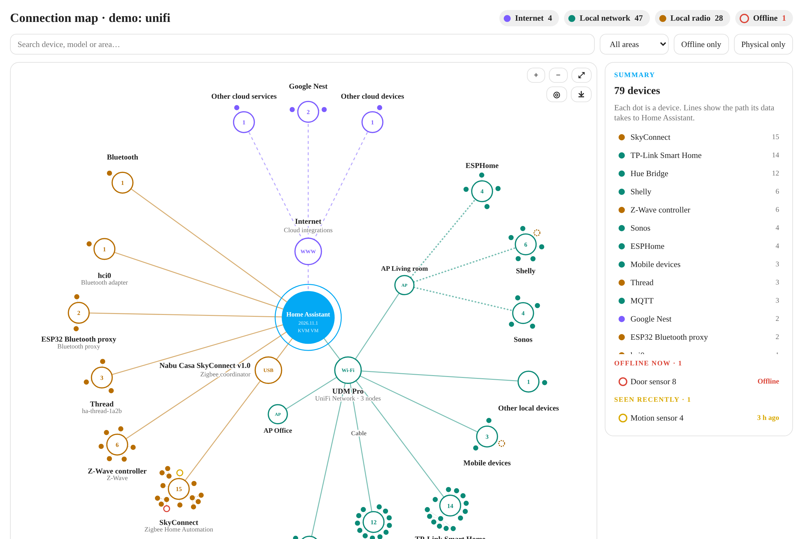

# Connection Map Card

A Lovelace card that shows **how every device reaches Home Assistant**: through the cloud, over your local network (directly, through an access point, or through a hub such as a Hue Bridge), or over a radio of its own (Zigbee, Z-Wave, Thread, Bluetooth).



*The built-in `demo: unifi` installation.*

Most network maps show one protocol at a time. This card draws all of them in one picture, so you can see at a glance which devices depend on the internet, which hub or access point each one sits behind, and what is offline right now.

It needs no configuration: it reads what Home Assistant already knows.

## Contents

- [Installation](#installation)
- [Adding the card](#adding-the-card)
- [Using the map](#using-the-map)
- [Options](#options)
- [How devices are placed](#how-devices-are-placed)
- [Router support](#router-support)
- [What needs an admin user](#what-needs-an-admin-user)
- [Rules the map keeps](#rules-the-map-keeps)
- [When something looks wrong](#when-something-looks-wrong)
- [Translating](#translating)
- [Contributing](#contributing)

## Installation

### HACS / Marketplace (custom repository)

1. Open **HACS → ⋮ → Custom repositories** (or the equivalent custom repository screen in the Marketplace).
2. Add `https://github.com/Ctuna89/ha-connection-map-card` with type **Dashboard**.
3. Install **Connection Map Card** and reload your browser.

### Manual

1. Download `ha-connection-map-card.js` from the [latest release](https://github.com/Ctuna89/ha-connection-map-card/releases/latest).
2. Copy it to `config/www/`.
3. Add it as a dashboard resource: **Settings → Dashboards → ⋮ → Resources → Add**, URL `/local/ha-connection-map-card.js`, type **JavaScript module**.

Home Assistant 2024.4 or newer.

## Adding the card

The card works best in a **panel** view, so it can use the full width. From the UI:

1. Open the dashboard where you want the map and click the pencil icon (**Edit dashboard**).
2. Click **+** in the tab bar to add a new view.
3. Give it a title (for example `Map`) and choose **Panel (single card)** as the view type. Save.
4. In the new view click **Add card**, scroll to the bottom and pick **Manual**.
5. Paste this and save:

```yaml
type: custom:connection-map-card
```

That is all. If you edit your dashboard in YAML, the same view looks like this:

```yaml
views:
  - title: Map
    path: map
    type: panel
    cards:
      - type: custom:connection-map-card
```

To see what the card does with hardware you don't have, add `demo: unifi`, `demo: fritz` or `demo: large` (about 350 devices).

## Using the map

Each dot is a device. Lines show the path its data takes to Home Assistant: a solid line is a cable, a dotted one is Wi-Fi, a dashed one goes through the internet.

**Looking around**

- **Tap a device** to see its full path, for example `Bedroom lamp → Hue Bridge → Philips Hue → Local network → Home Assistant`, and to open its device page.
- **Tap a hub or a group** to list its devices. The bridge itself is the first row.
- **Point at anything** (or use Tab) and it grows, its path to Home Assistant stays bright and the rest fades. Rows in the side panel highlight their device on the map.
- **Zoom and pan** with the mouse wheel, by dragging, or with the buttons. Device names appear when you zoom in far enough. While part of the map is out of view, a small overview appears in the corner; click or drag on it to move.
- On a phone the map starts zoomed in on Home Assistant, and a tap selects the nearest device.

**Filters**

- **Search** by name, model, area or integration, or pick an **area**.
- The status list next to the search narrows the map to **Offline only** (what is not answering) **No entities only** (devices that Home Assistant knows but that have no enabled entities, drawn in grey) or **Disabled only** (devices switched off with "Enable device" in Home Assistant, which are otherwise not on the map; offered when there are any).
- **Physical only** hides accounts, online services and loose sensors, and leaves the things you can touch.
- The coloured counters at the top switch internet, local network and local radio on and off.

**Buttons on the map**

- **◎** switches between the detailed map and a compact one, with one bubble per hub and a red counter for the devices that are offline.
- **⤓** saves what is on screen as a PNG, with or without names. Without names, hubs, routers, access points and devices are numbered, and the version, host and Thread network name are left out, so the image can be posted anywhere. The same menu has **Refresh mesh routes** and **Copy diagnostics**.

**Status**

| Mark | Meaning |
| --- | --- |
| Red ring | Offline: all the entities of the device report *unavailable*. Also used for a bridge. |
| Yellow ring | Seen recently: a battery device that went silent less than 24 hours ago is probably asleep, not gone. |
| Dashed amber ring | Off the network: the router reports it as disconnected (powered off or sleeping). For a phone: away from home, reaching Home Assistant over the internet. |

**Notices under the map**

The card never leaves something out silently. A strip under the map tells you when an access point could not be drawn, when labels are hidden at the current zoom, when a device could not be read, and when two entries look like the same device.

**Is this one device?**

One physical device is often set up through two integrations: a TV through its own integration and through its maker's cloud, a phone through the companion app and something else. When two entries only *look* alike (same name and maker), the card asks you, shows both side by side, and remembers your answer for your Home Assistant user, on every browser. Entries the router knows by the same network address are merged without asking, because that is certain. You can ask again from the ⤓ menu, or change the behaviour with `merge_duplicates`.

When the card does not notice, do it yourself: tap either device, choose **Merge with another device…** and pick the other one. A merged device has a **Split merged devices** button, which also undoes a merge the card made on its own.

## Options

Everything works without options. All of them can be set from the visual editor of the card, except `names`, `overrides`, `exclude_devices` and `z2m_base_topic`.

Option names are **stable from 1.0**: they will not be renamed or removed without a deprecation period. Options that were replaced keep working and are reported in the browser console, as are options the card does not know (usually a typo).

### Look

| Option | Type | Default | Description |
| --- | --- | --- | --- |
| `title` | string | `Connection map` | Card title. |
| `language` | string | Home Assistant's | Force the card language: `en` or `es`. |
| `layout` | string | `detailed` | `detailed` draws every device as a dot; `compact` draws one bubble per hub or integration. The ◎ button switches without changing the configuration. |
| `height` | number / string | automatic | Map height in pixels (for example `520`) or CSS length (`70vh`). In a Sections view, the card also supports Home Assistant's **Layout → Height** row slider (`grid_options.rows`) alongside *Fit height*. |
| `group_by_area` | boolean | `false` | Inside each hub, hang the devices of an area with more than one device from a small area node (hub → area → devices). Clicking the node filters the map to that area. A Zigbee mesh keeps its own shape instead. |
| `sort` | string | `area` | Order of the device lists: `area` (by area, then name) or `name`. The list of a hub has a button to switch. |
| `colors` | map | | Override colours: `cloud`, `local`, `radio`, `core` (Home Assistant), `offline`, `recent`, `away`, `no_entities`. |
| `lines` | map | | Line style per kind of link, each `solid`, `dashed` or `dotted`: `cloud` (default `dashed`), `local` (cable, `solid`), `wifi` (`dotted`), `radio` (`solid`). `width` sets the thickness (default `2`). |
| `sizes` | map | | Radius of each level of bubbles: `core` (Home Assistant, default `56`), `network` (router, coordinator, internet: `28`), `hub` (hubs and integrations: `22`), `device` (`6.2`). Below 48 the centre only says "HA". |
| `show_panel` | boolean | `true` | Show the side panel with the summary and details. |
| `minimap` | boolean | `true` | Show the overview map while part of the map is out of view. |
| `device_labels` | boolean | `true` | Show device names when zoomed in far enough. |
| `show_export` | boolean | `true` | Show the ⤓ button. |
| `animations` | boolean | `true` | Data flowing along the links, pop-in and hover effects. The system's reduced-motion setting is respected either way. |

### What is shown

| Option | Type | Default | Description |
| --- | --- | --- | --- |
| `physical_only` | boolean | `false` | Leave out everything that is not a physical device: entries that integrations register as services (accounts, APIs, weather) and the plain sensors of integrations without devices. The "Physical only" button switches it. |
| `group_small` | number | `1` | Integrations with this many devices or fewer (and no hub) are folded into an "Other …" group. Services and physical devices are never folded together, and radio integrations and mobile devices are never folded. `0` never folds. With more than 18 integrations of physical devices the card raises this to 2, and with more than 30 to 3, unless you set it yourself. |
| `separate_services` | boolean | `true` | Fold small integrations of services (accounts, APIs, a ping or a media server) and small integrations of physical devices into separate "Other …" groups. `false` folds them into one group per side, with fewer nodes on the map. |
| `merge_duplicates` | string | `ask` | What to do with two entries that look like the same device: `ask` (a question, remembered), `auto` (draw it once without asking) or `off` (leave both). Entries known by the same network address are merged in `ask` and `auto`. |
| `entities_without_device` | boolean | `true` | Draw the entities of device integrations that give them no device, MQTT entities written by hand included. |
| `devices_without_entities` | boolean | `true` | Draw devices that have no entities (a remote that only sends events, a lock its integration cannot control). |
| `show_trackers` | boolean | `false` | Show devices that only have `device_tracker` entities (every phone and laptop your router reports). |
| `show_disabled` | boolean | `false` | Keep the devices disabled in Home Assistant on the map, as grey dotted rings. Without it they only appear while "Disabled only" is chosen in the status list. |
| `show_mesh` | boolean | `true` | Load the Zigbee network map (Zigbee2MQTT or ZHA) and Matter Thread network diagnostics to show repeaters and signal quality. |
| `recent_hours` | number | `24` | How long a battery device that stopped answering counts as *seen recently* before it is shown as offline. `0` turns it off. The time is taken from when its entities became unavailable, so after a Home Assistant restart it counts from the restart. |
| `exclude_integrations` | list | `[]` | Integration domains to hide, for example `[mobile_app, bambu_lab]`. |
| `computers` | list | `[]` | Devices with the companion app that are desktop computers, by device name: they go to a "Computers" group instead of "Mobile devices". iMac, Mac mini, Mac Pro and Macs without a battery are recognised without listing them. `names: { computers: ... }` renames the group. |
| `exclude_devices` | list | `[]` | Device IDs to hide. An entity ID hides an entity that has no device. |

### Names and corrections

| Option | Type | Default | Description |
| --- | --- | --- | --- |
| `names` | map | `{}` | Rename integrations or groups, by integration domain or by the name shown. Example: `hisense_ac_plugin: Air conditioners`. |
| `overrides` | map | `{}` | Force an integration into a group: `cloud`, `local` or `radio`. Example: `bambu_lab: cloud` for a printer that talks to Home Assistant through its maker's cloud. |
| `main_router` | string | | The main router, when the card picks the wrong one: the device name as shown in Home Assistant, or the integration (`sagemcom_fast`, `unifi`, ...). |
| `router_name` | string | | Name shown for the local network node. |
| `coordinator_name` | string | | Name shown for the radio coordinator node. |
| `z2m_base_topic` | string | `zigbee2mqtt` | Zigbee2MQTT MQTT base topic. |
| `demo` | string | | Draw a synthetic installation instead of yours: `unifi`, `fritz` or `large`. Useful to try the card or to report a layout problem. |

```yaml
type: custom:connection-map-card
title: How my home is connected
physical_only: true
group_by_area: true
exclude_integrations:
  - bambu_lab
names:
  hisense_ac_plugin: Air conditioners
colors:
  cloud: "#8b5cf6"
lines:
  local: dashed
  width: 3
sizes:
  core: 40
  device: 7
```

### Replaced options

These keep working, and the visual editor writes the new form.

| Old | Use instead |
| --- | --- |
| `core_size: compact` | `sizes: { core: 28 }` |
| `mqtt_entities: false` | `entities_without_device: false`, or `exclude_integrations: [mqtt]` to hide only MQTT |
| `merge_duplicates: true` / `false` | `merge_duplicates: ask` / `off` |

## How devices are placed

| Group | Rule |
| --- | --- |
| **Internet** | The integration's `iot_class` is `cloud_push` or `cloud_polling`. |
| **Local network** | Everything else (`local_push`, `local_polling`). |
| **Local radio** | Zigbee (ZHA, Zigbee2MQTT, deCONZ), Z-Wave, Thread, Bluetooth, EnOcean, Insteon, 433 MHz. |

**Hubs.** A device is drawn behind a hub when Home Assistant links it to a parent device (`via_device`) that has at least two children or looks like a bridge. Virtual rooms, zones, Zigbee2MQTT groups and storage pools that some hubs expose are skipped. A parent that is just another device of the same integration, such as a power strip and its outlets, stays inside its integration's group with its children next to it.

**Access points.** With a router integration that reports its clients, every hub and device is attached to the access point it actually uses. Hubs on the main router sit in the middle of the local sector; each access point's hubs stay together at the sides.

**Mobile devices** are the phones, tablets and watches that run the companion app. At home each one is drawn on the access point it is on right now, and the map follows it when it moves. On mobile data, or away from home, its path becomes `Device → Mobile devices → Mobile data → Internet → Home Assistant`. The card cannot tell which remote access method is used (Home Assistant Cloud, a VPN, an exposed port), so it only says *Internet*.

**Zigbee.** The coordinator is the radio node: a Connect ZBT / SkyConnect / Yellow radio, or the adapter Zigbee2MQTT or ZHA reports. A network coordinator (SLZB-06 and the like) is named after the device Home Assistant knows at its address. With `show_mesh`, devices behind a repeater are drawn next to it with their link quality. Zigbee and Thread mesh routes are cached in the browser so repeaters appear on the first draw, and Zigbee2MQTT's over-the-air scan (4 h) and Thread diagnostics (1 h) refresh automatically when a new device appears or on demand via **Refresh mesh routes** in the ⤓ menu.

**Thread.** Matter devices on Thread get their own group immediately from their Thread entities and dataset, without waking sleepy battery sensors. With `show_mesh`, cached Matter `ThreadNetworkDiagnostics` neighbour and route tables place sleepy sensors and multi-hop routers behind their Thread repeater with RSSI and LQI. A Connect ZBT / SkyConnect stick is drawn as the Thread border router when OpenThread Border Router is set up and no Zigbee stack uses the stick. With ZHA and OTBR both present the card cannot tell, and keeps the stick as the Zigbee coordinator.

**Z-Wave.** The controller of the network (node 1: a USB stick, a Connect ZWA-2) is the hub of its nodes, linked straight to Home Assistant.

**Bluetooth.** A device registered by a Bluetooth address and no network address goes to a Bluetooth group, whatever its integration. For an admin user it is drawn behind the adapter or proxy that hears it best (for example an ESP32 running ESPHome), with its signal.

**Services and devices.** An entry that its integration registers as a service (an account, an API, a weather forecast) is not a thing in the house. Services and physical devices are never folded into the same "Other …" group, and "Physical only" hides the services.

**Without a device, or without entities.** Some integrations give their entities no device at all: each entity you can operate (light, switch, lock, cover, …) is a dot, and the integration's plain sensors are one dot. A device with no entities is drawn too; the card cannot know its status, so it is never shown as offline.

Helpers and local system plumbing (template, group, Supervisor, Sun, Backup, HACS, Spook and similar) are ignored, while Home Assistant Cloud stays as a cloud service; helper entities attached to a physical device do not override its integration. Devices whose only entities are `update` entities are ignored as well.

## Router support

The card reads what router integrations report about their clients. Huawei and UniFi have been tested on real hardware; the others follow the integrations' source code. Reports from people with this hardware are very welcome.

| Integration | Access point per client | Cable / Wi-Fi | Band | Status |
| --- | --- | --- | --- | --- |
| Huawei Mesh Router (HACS) | `connected_via` | `interface_type` | yes | Tested |
| UniFi Network | `ap_mac` / `sw_mac` → AP or switch | `is_wired` (`sw_port`, `wired_rate_mbps`) / `essid` | `radio` (ng / na / 6e) | Tested |
| UniFi Insights | `unifi_insights/topology` (switches, APs, VLANs) | wired port & speed / wireless | via UniFi Network if paired | Tested |
| AVM FRITZ!Box Tools | `connected_to` | `connection_type` (LAN / WLAN) | no | Untested on real hardware |
| NETGEAR / Orbi | *Access point MAC* sensor of each client (disabled by default: enable it) | *Link type* sensor (also disabled by default) | from the link type | Untested on real hardware |
| Sagemcom F@st (HACS `sagemcom_fast`; Bell, Sky, ...) | the gateway itself (it reports no access points) | `interface_type` of each tracker | not reported | Untested on real hardware |
| TP-Link Omada, ASUSWRT, OpenWrt (luci / ubus), Nmap, Ping | — | — | — | Routers and access points appear; clients are not linked to an access point because these integrations don't report it |

A client is matched to its device by MAC address (including masked prefixes), by the IP in the device's configuration URL or private LAN IP in its config entry, or by name when unambiguous.

## What needs an admin user

The card works for every user: it reads the device and entity registries the frontend already loads. Some details come from questions only an admin may ask, and are skipped quietly for other users.

| Detail | Without an admin user |
| --- | --- |
| Cloud or local, from each integration's `iot_class` | A built-in list of common cloud integrations is used instead. |
| Services | Recognised only when the device registry marks the entry as a service; the integration's own type is not available. |
| Entities without a device | Not drawn, except MQTT entities. |
| Which Bluetooth adapter or proxy hears each device | One plain *Bluetooth* group. |
| Which adapter Zigbee2MQTT uses, and the Zigbee / Thread mesh | The coordinator is named from the registry; no repeaters. |
| Host details (OS, virtual machine) | Not shown. |

## Rules the map keeps

The layout is built on a few rules, and the tests check them on the demo installations and on hundreds of random ones.

- **Links never cross**, and a link never runs over a bubble that is not one of its ends.
- **Dots never collide.** A device with children sits on a ring with its children on the next ring out, inside its own slice of the circle.
- **A group's own link reaches its bubble through a free lane**, not over its dots.
- **Labels never overlap** each other, a bubble, or the map's buttons. A label that does not fit is hidden until you zoom in.
- **Nothing is left out silently.** What cannot be drawn is counted in the strip under the map.

With a single group (for example a home with only its local network), that group's node sits at the centre and Home Assistant moves to the side, so the free space is used.

## When something looks wrong

1. Open the **⤓** menu and choose **Copy diagnostics**. It describes what the card found and how it classified each group. It contains **no names, addresses or entity IDs**: only integration domains, counts and settings.
2. Open an [issue](https://github.com/Ctuna89/ha-connection-map-card/issues) and paste it, with a screenshot if you can (the ⤓ button saves one without names).

If the map cannot be updated because of an unexpected piece of data, the card says so under the map and keeps the last map that worked. A single device that cannot be read is left out and counted, and the rest of the map is drawn.

Common cases:

| What you see | Why |
| --- | --- |
| A phone on the main router while it is on another access point | The router integration reports the client under a name that does not match the phone. |
| A cloud account under "Other cloud devices", or still there with "Physical only" | Its integration does not declare itself as a service. |
| "Network coordinator (address)" instead of the adapter's name | Home Assistant has no device with that address in its configuration URL. Set `coordinator_name`. |
| A device in the wrong group | Set `overrides` for its integration, and please open an issue with the integration name. |

## Translating

The card ships in English and Spanish. All its texts are at the top of `ha-connection-map-card.js`, one per line and in the same order in every language:

1. Copy the whole `en` block of `STR`, name it with the two-letter code Home Assistant uses (`de`, `fr`, …) and translate the values. `{t}` is a placeholder; keep it.
2. Do the same in `ED`, the texts of the visual editor.
3. Run the tests: they fail if a language does not have exactly the texts of English.

A text that is missing falls back to English. Pull requests with a new language are welcome.

## Contributing

Issues and pull requests are welcome.

The card is a single file with no build step. The tests load it in a headless browser, draw the demo installations and a few hundred random ones, and check the rules above, plus the behaviour of each feature.

```bash
npm install
npx playwright install chromium
npm test            # FUZZ=1000 npm test checks more random installations
```

A release is published automatically when the version in the card has no tag yet; its notes are that version's section of [CHANGELOG.md](CHANGELOG.md).

## License

[MIT](LICENSE)
