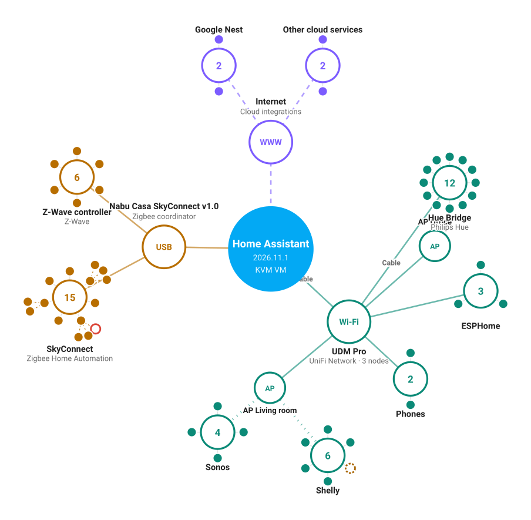

# Connection Map Card

A Lovelace card that shows **how every device reaches Home Assistant**: through the cloud, over your local network (directly or through a hub such as a Hue Bridge, IKEA DIRIGERA or an Aqara hub), or over a local radio coordinator (Zigbee2MQTT, ZHA, Z-Wave).



*The built-in `demo: unifi` installation.*

Most network maps show one protocol at a time. This card draws all of them in one picture, so you can see at a glance which devices depend on the internet, which hub each one sits behind, and what is offline right now.

## Features

- **Zero configuration.** Hubs and bridges are detected from the device registry (`via_device`), and each integration is placed in the cloud or local group from its `iot_class`.
- **Your real infrastructure.** Routers and access points from router integrations (UniFi, FRITZ!Box, Huawei, TP-Link Omada, ASUSWRT, …) become the local network node, the Zigbee coordinator (Connect ZBT-1, SkyConnect, Yellow, …) becomes the radio node, and the centre shows the host (Home Assistant OS version, virtual machine or bare metal).
- **Wi-Fi or cable.** With a router integration that reports its clients (Huawei Mesh Router, UniFi, FRITZ!Box) every hub and device is attached to the access point it actually uses, with a solid line for Ethernet and a dotted line for Wi-Fi (2.4 / 5 / 6 GHz). Even Home Assistant's own link is shown. See [router support](#router-support).
- **Zigbee mesh (Zigbee2MQTT and ZHA).** The card reads the Zigbee network map and shows which router (repeater) each device goes through, with its link quality (LQI).
- **Coordinator details.** The radio node shows the real adapter (for example *Connect ZBT-1* or *Sonoff Zigbee 3.0 USB Dongle Plus*), its stack and firmware, read from Zigbee2MQTT or ZHA.
- **Scales to big homes.** Large hubs are drawn as rings instead of trees, tiny integrations are grouped automatically when there are many, and access points sit next to the hubs they serve.
- **Demo mode.** `demo: unifi`, `demo: fritz` or `demo: large` draws a synthetic installation, so you can see what the card does with hardware you don't have.
- **Live status.** Offline devices (all entities `unavailable`) are outlined in red and listed in the side panel. Devices that your router reports as disconnected get a dashed amber ring (off the network: powered off or sleeping).
- **Motion.** Small dots travel along every link towards Home Assistant, devices pop in when the map loads, and the selected path speeds up. It respects the system's reduced-motion setting and can be turned off with `animations: false`.
- **Hover to follow a path.** Point at a device, a hub or a network node and it grows, its whole path to Home Assistant stays bright and the rest of the map fades (it is never hidden, so you keep the context). A tooltip shows the name, area and integration. The side panel is linked to the map: pointing at a row highlights that device or hub. It works with the keyboard too (Tab and Enter).
- **More detail as you zoom in.** Once the dots are far enough apart on screen, the devices in view show their names next to them.
- **Overview map.** When part of the map is outside the view (because of the zoom, or on a phone), a small overview appears in the corner with the visible part marked. Click or drag on it to move. It disappears when the whole map fits.
- **Visual editor.** Colours, line styles and width, the size of each level of bubbles and what is shown can be changed from the card editor, with a live preview.
- **Click to explore.** Tap a device to see its full path, for example `Bedroom lamp → Hue Bridge → Philips Hue → Local network → Home Assistant`, and open its device page.
- **Filter and search** by connection type, area, name or model, or show only offline devices.
- **Zoom and pan** with the mouse wheel, by dragging, or with the buttons. Labels keep the same size on screen at any zoom level. A label is never drawn over a node or over another label: it moves to a free side of its node, and if there is no room at the current zoom it is hidden until you zoom in.
- **Phone friendly.** On narrow screens the map is taller and starts zoomed in on Home Assistant, and a tap selects the nearest device or hub, so you don't have to hit tiny dots.
- Follows your Home Assistant theme, including dark mode.
- English and Spanish built in.

## Installation

### HACS / Marketplace (custom repository)

1. Open **HACS → ⋮ → Custom repositories** (or the equivalent custom repository screen in the Marketplace).
2. Add `https://github.com/Ctuna89/ha-connection-map-card` with type **Dashboard**.
3. Install **Connection Map Card** and reload your browser.

### Manual

1. Download `ha-connection-map-card.js` from the latest release.
2. Copy it to `config/www/`.
3. Add it as a dashboard resource: **Settings → Dashboards → ⋮ → Resources → Add**, URL `/local/ha-connection-map-card.js`, type **JavaScript module**.

## Usage

The card works best in a **panel** view, so it can use the full width. From the UI:

1. Open the dashboard where you want the map and click the pencil icon (**Edit dashboard**).
2. Click **+** in the tab bar to add a new view.
3. Give it a title (for example `Map`) and choose **Panel (single card)** as the view type. Save.
4. In the new view click **Add card**, scroll to the bottom and pick **Manual**.
5. Paste this and save:

```yaml
type: custom:connection-map-card
```

No other configuration is needed. If you edit your dashboard in YAML, the same view looks like this:

```yaml
views:
  - title: Map
    path: map
    type: panel
    cards:
      - type: custom:connection-map-card
```

### Options

| Option | Type | Default | Description |
| --- | --- | --- | --- |
| `title` | string | `Connection map` | Card title. |
| `group_small` | number | `1` | Integrations with this many devices or fewer (and no hub) are grouped into "Other cloud services" / "Other local devices". Use `0` to never group. |
| `exclude_integrations` | list | `[]` | Integration domains to hide, for example `[mobile_app, bambu_lab]`. |
| `exclude_devices` | list | `[]` | Device IDs to hide. An entity ID hides an MQTT entity that has no device. |
| `show_trackers` | boolean | `false` | Show devices that only have `device_tracker` entities (for example, every phone and laptop your router reports). |
| `sort` | string | `area` | Order of the device lists: `area` (by area, then name) or `name` (alphabetical). The list of a hub also has a button to switch between the two. |
| `core_size` | string | `large` | `compact` is a shortcut for `sizes.core: 28`. |
| `mqtt_entities` | boolean | `true` | Show MQTT entities that have no device (entities written by hand in YAML without a `device` block), one dot per entity. |
| `show_panel` | boolean | `true` | Show the side panel with the summary and details. |
| `animations` | boolean | `true` | Animated data flow, pop-in and hover effects. |
| `language` | string | HA language | Force the card language: `en` or `es`. |
| `names` | map | `{}` | Rename integrations or hubs, by integration domain or by the name shown. Example: `hisense_ac_plugin: Air conditioners`. |
| `colors` | map | | Override the colors: `cloud`, `local`, `radio`, `core` (Home Assistant), `offline`, `away`. |
| `lines` | map | | Line style per kind of link, each `solid`, `dashed` or `dotted`: `cloud` (default `dashed`), `local` (cable, `solid`), `wifi` (`dotted`), `radio` (`solid`). `width` sets the thickness (default `2`). |
| `sizes` | map | | Radius of each level of bubbles: `core` (Home Assistant, default `56`), `network` (router, coordinator, internet: `28`), `hub` (hubs and integrations: `22`), `device` (`6.2`). Below 48 the centre only says "HA". |
| `minimap` | boolean | `true` | Show the overview map while part of the map is outside the view. |
| `device_labels` | boolean | `true` | Show device names when zoomed in far enough. |
| `show_mesh` | boolean | `true` | Load the Zigbee network map (Zigbee2MQTT or ZHA) to show routers/repeaters and link quality. |
| `demo` | string | | Draw a synthetic installation instead of yours: `unifi`, `fritz` or `large` (about 350 devices). Useful to try the card or to report layout issues. |
| `z2m_base_topic` | string | `zigbee2mqtt` | Zigbee2MQTT MQTT base topic. |
| `router_name` | string | | Override the name shown for the local network node. |
| `coordinator_name` | string | | Override the name shown for the radio coordinator node. |
| `overrides` | map | `{}` | Force an integration into a group: `cloud`, `local` or `radio`. Example: `bambu_lab: cloud` for a printer that talks to Home Assistant through Bambu Cloud. |

```yaml
type: custom:connection-map-card
title: How my home is connected
group_small: 2
exclude_integrations:
  - mobile_app
colors:
  cloud: "#8b5cf6"
lines:
  local: dashed
  width: 3
sizes:
  core: 40
  device: 7
```

All of these, except `names`, `overrides`, `exclude_devices` and `z2m_base_topic`, can also be set from the visual editor of the card.

## How devices are classified

| Group | Rule |
| --- | --- |
| **Local radio** | The device belongs to a radio integration (ZHA, Z-Wave JS, deCONZ, Insteon, …) or is an MQTT device behind a Zigbee2MQTT bridge. |
| **Internet** | The integration's `iot_class` is `cloud_push` or `cloud_polling`. |
| **Local network** | Everything else (`local_push`, `local_polling`). |

A device is drawn behind a **hub** when it has a `via_device` and that parent device either has at least two children or looks like a bridge (few entities of its own). Virtual rooms and zones that some hubs expose (for example Hue rooms) are skipped.

A parent that is just another device of the same integration, such as a power strip and its outlets, is not treated as a hub when the integration has at least as many devices of its own: the strip and its outlets are drawn together inside the integration's group, and the outlet's path shows the strip.

**MQTT entities without a device**, the ones written by hand in YAML without a `device` block, are drawn as one dot each in the MQTT group. Tapping one opens the entity instead of a device page.

**Mobile devices** are the phones, tablets and watches that run the Home Assistant companion app. At home they are shown on the access point they use. When the app reports mobile data, or your router reports the device as away, the path becomes `Device → Mobile devices → Mobile data → Internet → Home Assistant`. The card cannot tell which remote access method the device uses (Home Assistant Cloud, a VPN such as Tailscale, or an exposed port), so it only says *Internet*.

Helpers and system integrations (template, group, Supervisor, Sun, Backup, HACS and similar) are ignored. Devices whose only entities are `update` entities are ignored as well.

### Network infrastructure

- **Router / Wi-Fi:** devices from router integrations are not drawn as dots. They become the local network node, and its panel lists every mesh node with its status.
- **Clients:** the router's `device_tracker` entities tell which access point each client uses and how (cable or Wi-Fi band). Devices are matched to trackers by MAC address, by the IP in their configuration URL, or by name. Extra access points are drawn between the main router and the hubs they serve, and a cloud device that is on your Wi-Fi shows that hop in its path too.
- **Coordinator:** a Connect ZBT-1 / SkyConnect / Yellow radio becomes the radio node. Otherwise the adapter is named from Zigbee2MQTT's `bridge/info` (serial port or network coordinator) or from the ZHA coordinator's manufacturer and model.
- **Host:** on Home Assistant OS / Supervised installs the centre shows the OS version and whether it runs in a virtual machine (VirtualBox, Proxmox/KVM, Hyper-V, …) or on bare metal.
- **Zigbee mesh:** for Zigbee2MQTT the card requests the network map over MQTT (it publishes to `<base_topic>/bridge/request/networkmap`); for ZHA it reads each device's neighbour table. Devices behind a router are drawn next to that router with a dashed orange line, and routers get an outer ring. Hubs with more than 30 devices keep the ring layout, ordered by router. Building the map can take a few seconds on large networks.

### Router support

The card reads the attributes that router integrations put on their `device_tracker` entities. Only Huawei has been tested on real hardware; the others follow the integrations' source code and the demo mode. Reports from people with this hardware are very welcome.

| Integration | Access point per client | Cable / Wi-Fi | Band | Status |
| --- | --- | --- | --- | --- |
| Huawei Mesh Router (HACS) | `connected_via` | `interface_type` | yes | Tested |
| UniFi Network | `ap_mac` → AP device | wired clients have no `essid` | `radio` (ng / na / 6e) | Untested on real hardware |
| AVM FRITZ!Box Tools | `connected_to` | `connection_type` (LAN / WLAN) | no | Untested on real hardware |
| TP-Link Omada, ASUSWRT, OpenWrt (luci / ubus), Nmap, Ping | — | — | — | Routers and APs appear in the local node; clients are not linked to an AP because these integrations don't report it |

Host details and the Zigbee mesh need an admin user; for other users the card simply skips them.

The card reads the device and entity registries that the frontend already loads, so it works for non-admin users. The integration list used for cloud/local detection needs an admin user; for other users the card falls back to a built-in list of common cloud integrations.

## Contributing

Issues and pull requests are welcome. If a device ends up in the wrong group, open an issue with the integration name and, if possible, its `iot_class`.

## License

[MIT](LICENSE)
